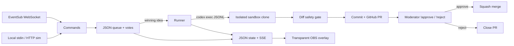

# Ship-It Stream

**Chat is the PM.** Viewers suggest small changes, vote in chat, watch Codex build the winner, and a moderator approves the pull request. Built for the Codex × TwitchCon hackathon. No Affiliate status, channel points, bits, or Twitch login needed for local testing.



## Setup

Requires Node **22**, npm, Git, and (for live implementation) the authenticated `codex` CLI and GitHub CLI `gh`. OAuth also needs `openssl` on PATH. Install Codex using the [official setup documentation](https://developers.openai.com/codex/quickstart), authenticate it separately, and run `gh auth login`. The operator must have permission to push branches and merge PRs in the sandbox repo. This bot does not install application dependencies or deploy infrastructure.

```sh
nvm use
npm install
npm run build
npm test
```

Copy `.env.example` to `.env` and fill it locally. The app reads **process environment only**; shell-export variables or use Node's built-in env loader:

```sh
export NODE_OPTIONS="--env-file=.env"
npm run dev:sim
```

Never commit or paste credentials into chat. `.env`, `.data/`, generated TLS keys, OAuth tokens, sandbox clones and runtime state are gitignored. `TWITCH_CLIENT_ID` and `TWITCH_CLIENT_SECRET` are read only from the environment. No raw OAuth responses, token values, or subprocess output are logged.

## Run the local loop

```sh
export SANDBOX_REPO=kyl3kan3/ship-it-sandbox
export DRY_RUN=1
npm run dev:sim
```

This runs **real Codex** with simulated chat. `DRY_RUN=1` creates a local commit and lets moderator approval squash-merge it into the clone's local default branch; it never pushes, creates a PR, or updates the remote. Subsequent local rounds build on that approved local branch. Use a throwaway repository with application source, such as `app/page.js`. A local path to a bare Git remote works as `SANDBOX_REPO` too. For real PRs, unset `DRY_RUN` (or set it to `0`).

Open `http://127.0.0.1:8787/overlay`. Add the same URL as a **1920 × 1080 OBS browser source**; its background is transparent. The overlay has a queue, vote bars and countdown, coding ticker, file/+/- summary, PR and preview URL text, and approval banner. It needs no external fonts, scripts, or QR service.

Paste one JSON object per line into stdin, or send HTTP requests:

```sh
curl -X POST http://127.0.0.1:8787/sim/chat \
  -H 'Content-Type: application/json' \
  -d '{"userId":"alice","name":"Alice","text":"!ship Add a purple card","badges":[]}'
```

Example stdin session (pause briefly between commands from the same user; default cooldown is 1.5s):

```jsonl
{"userId":"alice","name":"Alice","text":"!ship Add a card","badges":[]}
{"userId":"bob","name":"Bob","text":"!ship Make the theme purple","badges":[]}
{"userId":"carol","name":"Carol","text":"!ship Improve the heading copy","badges":[]}
{"userId":"mod","name":"Mod","text":"!startvote","badges":["moderator"]}
{"userId":"alice","name":"Alice","text":"!vote 2","badges":[]}
{"userId":"bob","name":"Bob","text":"!vote 2","badges":[]}
{"userId":"mod","name":"Mod","text":"!endvote","badges":["moderator"]}
```

Wait for `Ready for review`, inspect the clone's diff or linked PR, then send:

```jsonl
{
  "userId": "mod",
  "name": "Mod",
  "text": "!approve",
  "badges": [
    "moderator"
  ]
}
```

`!reject` closes a real PR (or marks a local build rejected). Sim badges are intentionally operator-supplied; **the sim endpoint exists only in sim mode**. The server binds to loopback and rejects cross-origin browser POSTs. Do not expose the simulator to the internet.

## Live Twitch

Register a Twitch application with this exact redirect URI:

```text
https://localhost:3000/auth/callback
```

Set `TWITCH_CLIENT_ID`, `TWITCH_CLIENT_SECRET`, and `TWITCH_BROADCASTER_ID` in your local environment. `TWITCH_BOT_ID` is optional and otherwise comes from the validated token identity. Authorize while signed in as the bot account. If you set the bot ID, validation requires that identity.

```sh
npm run auth
```

Open the printed **local authorization URL**, `https://localhost:3000/auth`, and accept the self-signed localhost certificate. It redirects in the browser to Twitch's authorize URL. This indirection keeps the client ID out of terminal output. The server exchanges the callback code, checks OAuth state, validates identity/scopes, and saves `.data/tokens.json` with mode 0600. Stop the auth server after authorization.

Requested scopes: `user:read:chat user:write:chat user:bot channel:bot moderator:read:chatters`. This implementation uses a **user access token and WebSocket transport**; it doesn't require Affiliate features. Twitch's current account, bot, moderation, and chat access policies still apply. See [Twitch chat authentication](https://dev.twitch.tv/docs/chat/authenticating/) and [WebSocket lifecycle](https://dev.twitch.tv/docs/eventsub/handling-websocket-events/).

```sh
npm run build
npm start
```

The bot validates tokens at startup and hourly, refreshes near expiry and on API 401, subscribes `channel.chat.message` v1 on session welcome, deduplicates notifications, monitors keepalive, migrates reconnect sessions without resubscribing, reconnects and resubscribes on unexpected disconnect, and stops on revocation. Missed Twitch events during downtime cannot be replayed. Replies use Helix `POST /chat/messages`.

## Commands and configuration

| Command               | Who             | Effect                                           |
| --------------------- | --------------- | ------------------------------------------------ |
| `!ship <idea>`        | Everyone        | Queue an allowed request, max 280 characters     |
| `!queue`              | Everyone        | Show queued requests                             |
| `!vote N`             | Everyone        | One immutable vote per user per round            |
| `!status`, `!help`    | Everyone        | Show progress or commands                        |
| `!startvote`          | Mod/broadcaster | Open a round with the earliest queued candidates |
| `!endvote`            | Mod/broadcaster | End immediately and implement the winner         |
| `!approve`, `!reject` | Mod/broadcaster | Merge or close the pending PR                    |

Mod permissions come from EventSub `moderator` / `broadcaster` badge set IDs, never display names. Rounds begin with a mod command, then end automatically after the configured duration or by mod command. The most votes wins; ties (including no ballots) go to the earliest submitted candidate. Losing candidates stay queued. One build/review at a time. Each user has a 1.5-second command cooldown. Queue is capped at 100 requests. `PointsHook` in `votes.ts` is pluggable and **disabled by default**.

| Variable           | Default                                                      |
| ------------------ | ------------------------------------------------------------ |
| `SANDBOX_REPO`     | `kyl3kan3/ship-it-sandbox` (GitHub slug or local Git remote) |
| `CODEX_BIN`        | `codex` (single executable path, no shell arguments)         |
| `DRY_RUN`          | off; `1` enables local-only mode                             |
| `PORT`             | `8787`, bound to `127.0.0.1`                                 |
| `VOTE_DURATION_MS` | `180000`                                                     |
| `VOTE_CANDIDATES`  | `5`                                                          |
| `MAX_DIFF_FILES`   | `8`                                                          |
| `MAX_DIFF_LINES`   | `400` added + removed                                        |

State persists in `.data/state.json` with atomic replacement. A restarted vote resumes its deadline. An interrupted build becomes failed and requires operator inspection. A pending review survives restart. Event history is bounded. HTTP: `GET /state`, `GET /events` (SSE), `GET /overlay`, and sim-only `POST /sim/chat`.

## Codex and the safety model

The runner clones/fetches into `.data/sandbox`, branches `ship/<uuid>` from the remote default branch, then invokes:

```text
codex exec --json --sandbox workspace-write -C <clone> "<templated prompt>"
```

The template identifies viewer input as untrusted and limits work to small application-source edits. See [official non-interactive Codex documentation](https://developers.openai.com/codex/noninteractive). A ten-minute process timeout and bounded output prevent indefinite runs. Only JSONL event **types** enter the ticker; raw model text and command output never enter state. The Codex subprocess gets a narrow environment allowlist with its own authentication variables; Twitch and GitHub token environment variables are excluded.

Requests are classified with deterministic keyword rules into `copy`, `theme`, `component`, `page`, or `bugfix`. A denylist blocks secret/credential access, environment changes, dependency installs, workflows, external fetching, eval, and similar requests. This is a conservative hackathon filter, not a semantic security guarantee.

After Codex exits, the runner stages changes (including new files), rejects changed Git HEAD, binary files, symlinks and submodules, enforces file/line budgets, and blocks manifests, lockfiles, `.github/`, `.env*`, and `next.config.*`. It commits only after passing the gate. Live mode pushes the feature branch and opens a PR using `gh`; preview discovery polls checks and deployment statuses for up to two minutes, best effort. Only confirmed `*.vercel.app` preview URLs appear; absence never blocks review. Approval uses squash merge pinned to the reviewed commit SHA. Changed local HEAD or dirty files block approval.

**Use a dedicated disposable sandbox repository and a restricted OS/container account.** Keyword and diff gates do not prove generated code safe, and Codex authentication in the operator's home is still accessible according to its sandbox policies. Do not put secrets in the sandbox, give it production credentials, or treat this as a hostile-code isolation boundary. A moderator should inspect the entire PR and required repository checks before approval. Repo branch protection remains authoritative.

Failures stop the build without pushing unsafe changes; the UI reports a generic safe error. Inspect the local sandbox for diagnosis. To recover a failed/dirty clone, stop the bot, archive or remove `.data/sandbox`, then restart. Removing `.data/state.json` resets the queue/review history. Never remove an active sandbox while Codex is running. A diverged dry-run branch is stopped for operator reconciliation instead of discarding local work.

## Headless verification

`npm test` builds TypeScript and uses `node:test`; no Twitch login, network calls, GitHub access, Codex account, or browser is used by the tests. Tests cover parsing, permissions, cooldowns, classification/denylist/diff gates, voting and timers, persistence, recorded-protocol EventSub fixtures, mocked OAuth refresh/validation, and an end-to-end HTTP sim session with three proposals and a fake executable that edits `app/page.js` and emits JSONL. The E2E uses a temporary bare Git remote, asserts diff state and SSE/overlay availability, approves as a mod, verifies a local squash merge, and verifies the remote was untouched. Failure tests block unsafe output and post-review tampering.

Source: `bot/src/`; tests: `bot/test/`; static OBS UI: `overlay/index.html`. Runtime dependencies: none. Development dependencies: TypeScript and Node type declarations.

MIT licensed. See [LICENSE](LICENSE).
